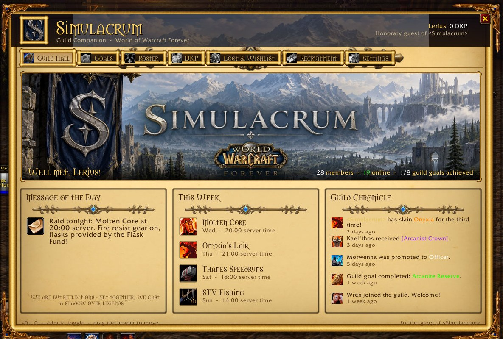
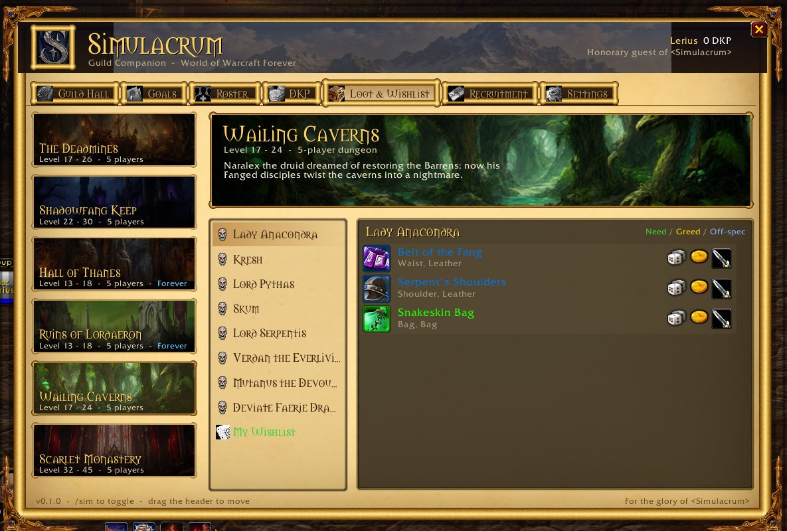
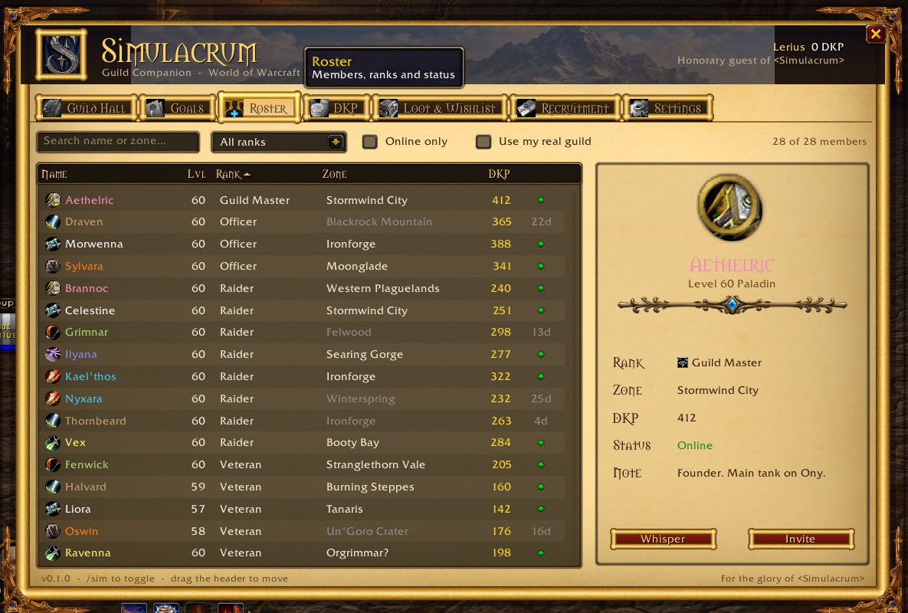
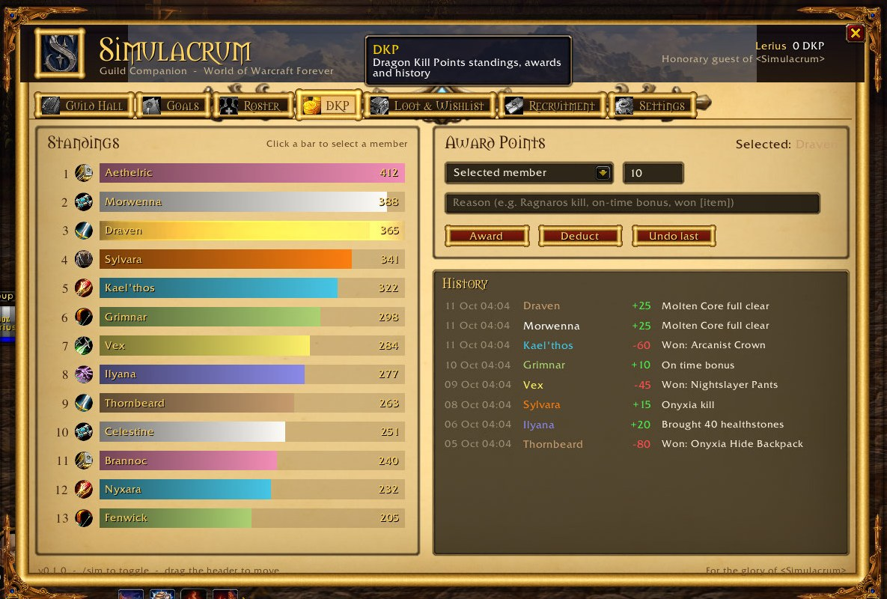
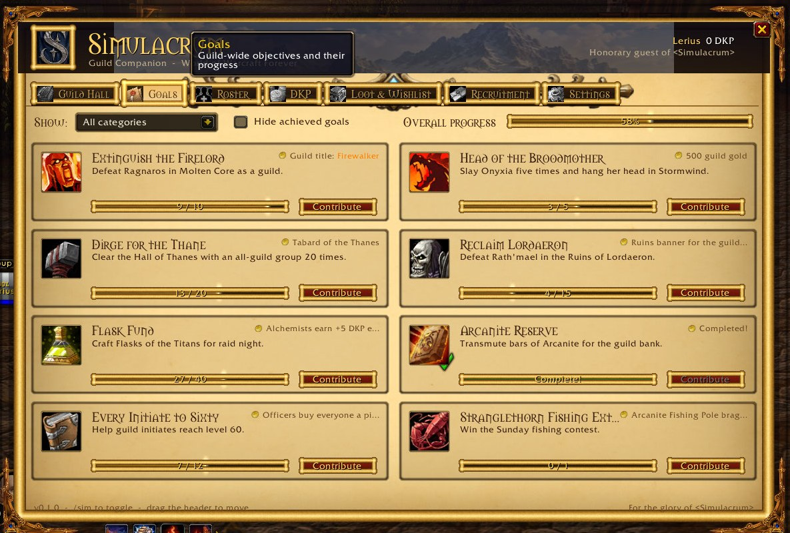

# Simulacrum — Guild Companion for World of Warcraft Forever

A showcase addon for **WoW Forever** (Interface `16001`) built around the fictional guild **&lt;Simulacrum&gt;**.
It opens from a standard minimap button (LibDBIcon) or `/sim`, and demonstrates a full themed UI kit:
parchment backgrounds, gold metal frames with filigree corners, tab groups, sortable tables, virtual
scroll lists, buttons, inputs, selects, text areas, checkboxes, sliders, progress bars, images,
item icons with live tooltips, and guild-synced data via addon messages.



| Loot & Wishlist | Roster |
| --- | --- |
|  |  |
| **DKP** | **Goals** |
|  |  |

## Tabs

| Tab | What it shows |
| --- | --- |
| **Guild Hall** | Banner, welcome, message of the day (live guild MOTD if you are in a guild), weekly events, guild chronicle |
| **Goals** | Guild-wide goals with progress bars, category filter, "hide achieved", contribute buttons |
| **Roster** | Sortable member table (class icons/colours, rank, zone, DKP, status), search, rank filter, live-guild toggle, details panel with whisper/invite |
| **DKP** | Class-coloured standings bar chart, award/deduct form, undo, history log |
| **Loot & Wishlist** | AtlasLoot-style dungeon browser: illustrated dungeon list, bosses, item icons with quality borders and real item tooltips. Declare **Need / Greed / Off-spec** interest; it is broadcast to guild members running the addon and shown in tooltips. Shift-click links, Ctrl-click dresses up. |
| **Recruitment** | Application form (input, select, slider, checkboxes, text area with counter) and an applicant list with accept/decline |
| **Settings** | Minimap toggle, sounds, interest sharing, window scale slider, MOTD override, reset, about |

Item IDs come from AtlasLoot Forever's data, including Forever-only dungeons (Hall of Thanes, Ruins of Lordaeron).

## Install

Copy (or junction) `Simulacrum/` into `World of Warcraft\_classic_beta_\Interface\AddOns\`.

For development on Windows a junction avoids copying:

```powershell
New-Item -ItemType Junction -Path "C:\Program Files (x86)\World of Warcraft\_classic_beta_\Interface\AddOns\Simulacrum" -Target "C:\r\wow-forever-addon\Simulacrum"
```

## Commands

- `/sim` — toggle the window · `/sim minimap` — toggle the minimap button · `/sim reset` — wipe saved data
- `/simshot` — take a screenshot · `/simerr` — enable Lua error popups (dev helpers)

## Artwork

The banner was provided; everything else (parchment, gold corners and divider, dungeon paintings) was generated
locally with **Qwen-Image 2.1** on ComfyUI, and the gold frame edge is procedural.

```bash
python tools/gen_art.py          # needs ComfyUI on 127.0.0.1:8188 with Qwen-Image 2.1
python tools/build_textures.py   # converts art/ into power-of-two TGAs in Simulacrum/Media
```

## Layout

```
Simulacrum/
  Simulacrum.toc
  Core.lua       namespace, SavedVariables, event bus, addon-message sync, slash commands
  Data.lua       demo guild: ranks, members, goals, dungeons and loot, news
  Widgets.lua    themed widget kit (frames, buttons, tabs, inputs, select, table, list, item buttons...)
  Minimap.lua    LibDataBroker launcher + LibDBIcon button
  UI/            one file per tab
  Libs/          LibStub, CallbackHandler, LibDataBroker, LibDBIcon
  Media/         textures
tools/           art generation and texture build scripts
art/             source and generated art
```
